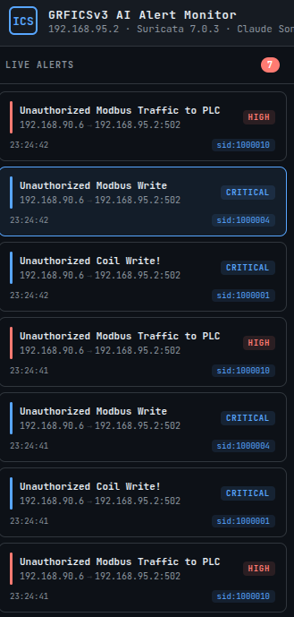

# GRFICSv3 ICS Detection Lab

End-to-end ICS security lab: adversary emulation against a simulated chemical reactor, custom Suricata detections for Modbus attacks, and a Claude-powered alert enrichment pipeline that gives SOC analysts real-time context on what each alert actually means.

> **Status:** Active portfolio project. See [Project status and roadmap](#project-status-and-roadmap) for what is implemented, what is planned, and known limitations.

> **Disclaimer:** Every attack documented here targets an isolated, self-hosted GRFICSv3 simulation with no connection to real industrial equipment. This repo is published for security education and authorized-research purposes only, it is not instruction for attacking real production ICS/OT environments. Unauthorized access to real industrial control systems is illegal and can cause physical harm.

## Overview

This is a portfolio project documenting full-stack ICS security work against [GRFICSv3](https://github.com/Fortiphyd/GRFICSv3), Fortiphyd Logic's Dockerized chemical reactor simulation. It covers the complete attacker and defender loop: reconnaissance, Modbus register manipulation, replay attacks, and MITM concealment, followed by custom Suricata detections and an LLM-enriched alert pipeline built to reduce analyst triage time.

The three core technical contributions:

1. **AI-enriched alert pipeline** (`ics_alert_pipeline.py`) that tails Suricata's `eve.json` in real time, sends each alert to Claude with an ICS-specific system prompt, and serves enriched analysis to a browser dashboard.
2. **Six custom Suricata rules** targeting Modbus adversary tradecraft: unauthorized coil writes, register writes, PLC program uploads, replay activity, reconnaissance, and a broad catch-all.
3. **Full attack catalog** across four stages including ARP-spoofed MITM, coil manipulation, IEC 61131-3 Structured Text injection into PLC ladder logic, and packet replay.

## Dashboard

<table>
<tr>
<td></td>
<td></td>
</tr>
<tr>
<td>Live dashboard view</td>
<td>AI-enriched alert detail</td>
</tr>
</table>

The dashboard polls the enrichment service every 3 seconds and displays each alert with severity, attack classification, physical process impact, and a recommended analyst action, all generated by Claude in the context of the running simulation.

## Repository contents

| File | Purpose |
|------|---------|
| `GRFICSv3 Documentation.md` | Full technical writeup of the attacks, defenses, and findings |
| `ics_alert_pipeline.py` | Flask service that enriches Suricata alerts using the Claude API |
| `dashboard.html` | Browser dashboard polling the pipeline for real-time alert display |
| `local.rules` | Custom Suricata detection rules for Modbus attacks |
| `modbus_mitm_conceal.py` | NFQUEUE/Scapy script used in the MITM concealment attack (falsifies FC4 register readings in transit) |
| `GRFICSv3 Documentation-media/` | Documentation images and screenshots |
| `evals/` | Frozen-input eval harness for the AI enrichment pipeline: `run_evals.py`, `inputs/`, `expected/` |
| `skills/` | Claude Code project skills used to build and operate this lab (lab startup/shutdown, attack test commands, Suricata rule workflow) |

## The AI enrichment pipeline

Raw Suricata Modbus alerts tell an analyst that a rule fired, but not what the attack means in the context of the physical process. A "coil write to 192.168.95.2 register 40" alone does not tell the operator whether the HMI can still be trusted or whether the reactor itself is at risk. `ics_alert_pipeline.py` closes that gap by feeding each alert to Claude Sonnet with an ICS-specific system prompt describing the GRFICSv3 process, Modbus function codes, register semantics, and the meaning of every custom SID in `local.rules`.

**Architecture:**

1. A background thread tails `/var/log/suricata/eve.json` line by line as Suricata writes it.
2. Each new alert is parsed and sent to Claude (`claude-sonnet-4-6`) with the ICS system prompt.
3. Claude returns structured JSON: severity, attack classification, physical process impact, and recommended analyst action.
4. A Flask endpoint on `localhost:5000` serves the enriched alerts to `dashboard.html`, which polls every 3 seconds.

**Hardening added during development:**

* Forced tool use: Claude is required to call a schema-defined tool (`submit_alert_analysis`) instead of writing free-form JSON, which eliminates the class of failures caused by stray text, markdown fences, or inconsistent quoting around the output.
* A `_valid_analysis()` check as a second line of defense, confirming all required fields are present and `severity` is one of the four allowed values before trusting the result.
* `max_tokens` raised from 800 to 1500 after tracing a bug where longer explanations caused Claude to hit the token ceiling mid tool-call, silently dropping the `actions` and `tags` fields.
* Graceful fallback objects (tagged `schema-error` or `api-error`) instead of a dropped alert, so a parsing or network failure still surfaces in the dashboard with a trace of what happened, rather than the alert vanishing.
* A hardcoded per-SID severity floor (`MIN_SEVERITY`): the model's assigned severity can only be raised to the floor, never lowered, so a coil write or program upload can never be silently under-rated. When the floor overrides the model, that's logged transparently in `severity_reason` and tagged `severity-floor-applied`, never applied silently.
* MITRE ATT&CK for ICS technique tagging: each alert is grounded with a pre-vetted per-SID technique hint (`MITRE_HINTS`) rather than trusting the model's free recall, to avoid hallucinated technique IDs.

**API key handling:** The script reads `ANTHROPIC_API_KEY` from the environment at runtime via `os.environ.get()`. The key is never hardcoded.

## AI output evaluation

Prompt, model, and parsing changes are regression-tested against a frozen set of real captured alerts (`evals/`) before they ship, rather than relying on manual spot checks in the terminal. This is the "Deployment Diligence" side of shipping an AI-integrated tool: an eval harness that turns "does this still work" into a repeatable, comparable pass/fail run.

* `evals/inputs/` holds six frozen `eve.json`-shaped alerts (five real captures, one clearly-flagged synthetic case for the highest-impact rule) covering the full detection catalog.
* `evals/expected/` holds the matching expected-output spec per case: structured fields like severity are checked with an "at least this floor" comparison tied to the same `MIN_SEVERITY` invariant built into the pipeline, since exact-matching a model-generated field is brittle against harmless wording variance; free-text fields are checked with length bounds and required keywords rather than exact text.
* `category` and `requires_human_review` are derived by the harness itself from the SID, not asked of the model, since they're deterministic facts about which rule fired rather than a judgment call.

Run it with:

```bash
python3 evals/run_evals.py
```

Exits `0` if all cases pass, `1` if any fail, with a `PASS`/`FAIL <field> expected X got Y` line per case.

## Custom Suricata detections

Six custom rules in `local.rules`:

| SID | Detection |
|------|-----------|
| 1000001 | Unauthorized Modbus coil write from non-authorized source IPs |
| 1000002 | Unauthorized Modbus holding register write |
| 1000003 | PLC program upload via HTTP POST to OpenPLC web portal |
| 1000004 | Broad Modbus write and replay activity |
| 1000006 | Reconnaissance and SYN scanning against the ICS subnet |
| 1000010 | Broad catch-all for unhandled Modbus anomalies |

**Configuration notes:**

* Modbus detection required setting `enabled: yes` under the Modbus block in `suricata.yaml` (disabled by default).
* Suricata had to run on the physical NIC (`eno1`) rather than a Docker bridge interface, because GRFICSv3's networks are macvlan. This is a non-obvious gotcha that took real debugging to sort out.

## Attack catalog

The full documentation covers four attack stages plus a defensive detection phase:

* **Stage 1** Reconnaissance and environment mapping (Nmap sweeps, subnet identification, PLC and HMI discovery)
* **Stage 2** ARP spoofing with `arpspoof`, traffic capture with Wireshark, and Modbus protocol analysis
* **Stage 3** Modbus register manipulation via `pymodbus` one-liners: coil writes to disable the chemical reactor program, holding register writes to falsify setpoints
* **Stage 4** MITM concealment (rewriting register values in transit via NFQUEUE + Scapy), Structured Text injection into PLC ladder logic, and replay attack from captured `.pcap` traffic
* **Stage 5** Defensive detection and AI-enriched alert analysis (this repo's Suricata ruleset and pipeline)

## Setup

**Prerequisites:** Ubuntu with Docker (WSL2 if on Windows), Suricata 7.x, Python 3, and a running GRFICSv3 simulation. Follow [Fortiphyd's setup guide](https://github.com/Fortiphyd/GRFICSv3) for the simulation itself.

**Install the pipeline dependencies:**

```bash
pip install flask anthropic --break-system-packages
```

**Deploy the custom rules:**

```bash
sudo cp local.rules /var/lib/suricata/rules/local.rules
sudo suricata -T -c /etc/suricata/suricata.yaml -v
```

The second command runs Suricata's config test to catch rule syntax errors before going live.

**Run Suricata live on the correct interface:**

```bash
sudo suricata -c /etc/suricata/suricata.yaml -i eno1
```

Replace `eno1` with your physical NIC name if different. Use `docker network inspect` to confirm which interface your GRFICSv3 macvlan networks are riding on.

**Start the enrichment pipeline:**

```bash
export ANTHROPIC_API_KEY="sk-ant-your-key-here"
python3 ics_alert_pipeline.py
```

Then open `dashboard.html` in a browser.

## Project status and roadmap

This is an active portfolio project. The core detection layer (custom Suricata ruleset, live alert capture, and AI enrichment pipeline) is fully functional and demonstrated end-to-end in the documentation. The following pieces are scoped and planned but not yet implemented, and are documented here so the current scope is transparent.

### Planned phases

**Phase 5: Wazuh SIEM integration.** Feeding Suricata's `eve.json` into a Wazuh Docker stack for aggregation, correlation, dashboarding, and alerting on top of the AI enrichment layer. This closes the red-to-blue loop into a full SOC workflow. Wazuh is installed on the host but the Suricata feed and dashboards are not yet configured.

**Phase 4 completion: IPS conversion.** Converting Suricata from IDS (alert-only) to inline IPS (drop) mode for high-confidence surgical rules. Rules 1000001 through 1000003 are strong candidates for `drop` because they are surgical and false-positive risk is low. The broad catch-all (1000010) will stay as `alert` only to avoid disrupting legitimate traffic during false-positive investigation.

**Product valve attack (Stage 4 experiment).** The register hammer attack against the purge valve (register 102) demonstrated that I can beat the PLC's control loop in a write race, but pressure never physically moved. This surfaced the finding that register 102 is a Modbus-exposed mirror rather than the physical actuator. Attacking register 103 (product valve, which draws mass out of the reactor) is a candidate for producing a real physical impact and is left as a future experiment.

### Known limitations

**Tool-call completeness under token budget.** Forced tool use eliminates format drift (Claude can no longer wander outside the schema), but it does not guarantee the call finishes before hitting the token ceiling. A sufficiently long explanation can still get the `actions`/`tags` fields cut off mid-generation, which is what raising `max_tokens` to 1500 fixed for the cases observed so far. This class of regression is now caught automatically: the eval harness (`evals/`, see above) runs a high-severity frozen case through the real pipeline and would fail loudly instead of needing a live re-test to notice.

**Suricata 7.0.3 ARP alerting.** Rule 1000005 (ARP spoofing detection) was designed but abandoned because Suricata 7.0.3 does not implement `alert arp` signatures despite the configuration toggle existing. This is documented in the writeup as a real-world tooling gap. Detection of the ARP-based MITM attack currently relies on the downstream Modbus rules catching the falsified traffic rather than the ARP layer itself.

## Credits and licensing

The GRFICSv3 simulation is developed by [Fortiphyd Logic](https://www.fortiphyd.com/) and licensed under their terms. Upstream repo: [github.com/Fortiphyd/GRFICSv3](https://github.com/Fortiphyd/GRFICSv3). This repository contains only my own work: documentation, custom Suricata rules, the AI enrichment pipeline, and the dashboard. No GRFICSv3 source code is included or redistributed here.

## About

Portfolio project by Nathaniel, CyberAICorps Scholarship for Service (SFS) recipient at Cal State San Bernardino. Career focus: ICS and OT critical infrastructure security, with interest in CISA, DoE/CESER, and Idaho National Laboratory.
